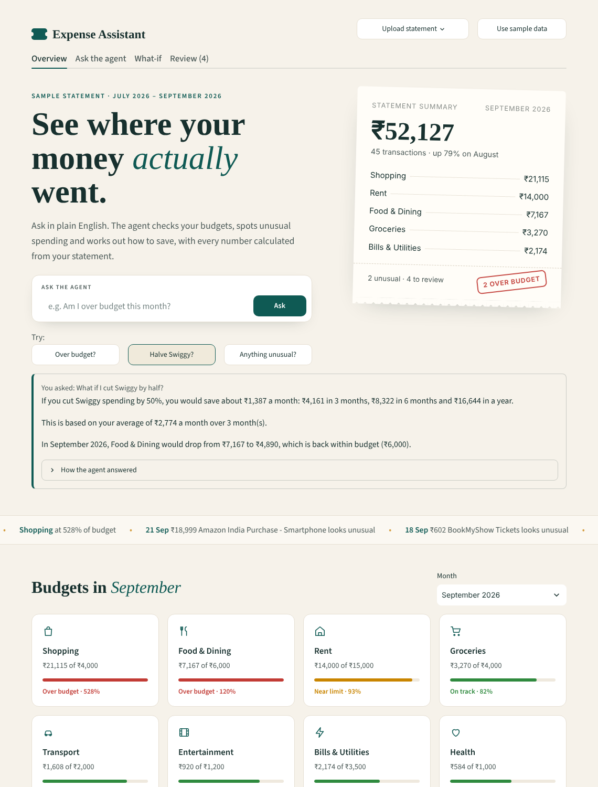
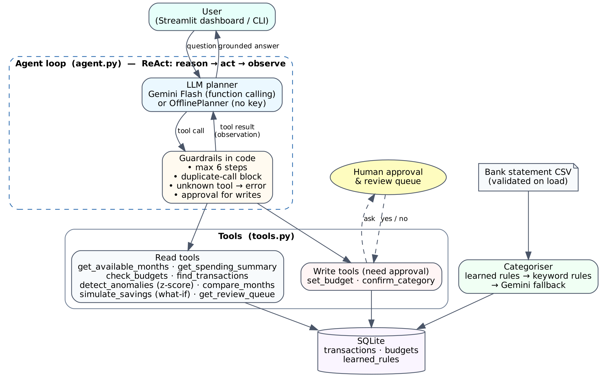

# Expense Assistant Agent

An agentic AI assistant that reads a bank-statement CSV, puts each transaction in a category, checks your spending against monthly budgets, flags unusual transactions and answers plain-English questions such as *"Am I over budget this month?"*.

The LLM (Google Gemini) decides **which tools to call**. The tools do every calculation, so the numbers in an answer come from the data and are not made up by the model.

**Live app:** https://expense-assistant-agent.streamlit.app





## Features
- **ReAct agent loop**: the agent reasons, calls a tool, reads the result and repeats until it can answer. The loop is capped at 6 steps.
- **10 tools**: spending summary, budget check, transaction search, z-score anomaly detection, month comparison, **what-if savings simulator**, review queue, set budget, confirm category, available months.
- **Web app**: an Overview page with an ask bar, a receipt-style month summary, highlights, budget cards and charts; a chat that shows each answer's tool steps as a timeline and asks for Approve / Reject before any change; an interactive what-if slider; a review queue.
- **Human in the loop**: changing a budget or a category only happens after the user approves it. Categories the system is unsure about go to a review queue, and each correction is learned for future statements.
- **Safety**: CSV rows are validated before loading, SQL queries are parameterised, the API key is kept in `.env`, and transaction text is passed to the model as labelled data. A description in the sample data contains a prompt-injection attempt, and the tests check that it has no effect.
- **Resilient to model changes**: tries `gemini-3.8-flash` first and moves to the next available Flash model if one is retired or not enabled for your key; if Gemini fails, the agent answers with the offline planner and says so.
- **Works without an API key**: an `OfflinePlanner` follows the same protocol as Gemini, so the app, the demo and the tests all run without a key.

## Setup
```bash
python -m venv .venv && source .venv/bin/activate      # Windows: .venv\Scripts\activate
pip install -r requirements.txt
cp .env.example .env        # then paste your free key from https://aistudio.google.com/apikey
```

## Run
```bash
streamlit run app.py                 # web app
python cli.py --trace                # chat in the terminal and see every tool call
python cli.py --offline -q "Any unusual transactions?"
python scripts/run_demo.py           # scripted demo -> evidence/demo_transcript_<mode>.md
python -m pytest -v                  # 56 tests
```

To use your own data, upload a CSV with the columns `date` (YYYY-MM-DD), `description` and `amount`.

## Project layout
```
expense_agent/
  agent.py        agent loop, guardrails, system prompt
  gemini.py       Gemini function-calling adapter + LLM categoriser
  offline.py      rule-based planner (no API key)
  tools.py        the 9 tools and their JSON schemas
  categorizer.py  learned rules -> keyword rules -> LLM fallback
  store.py        SQLite storage and validated CSV import
app.py            Streamlit UI
cli.py            terminal UI
tests/            pytest suite
data/             sample statement (Jul-Sep 2026) and budgets
evidence/         test output, demo transcripts, screenshots
```
